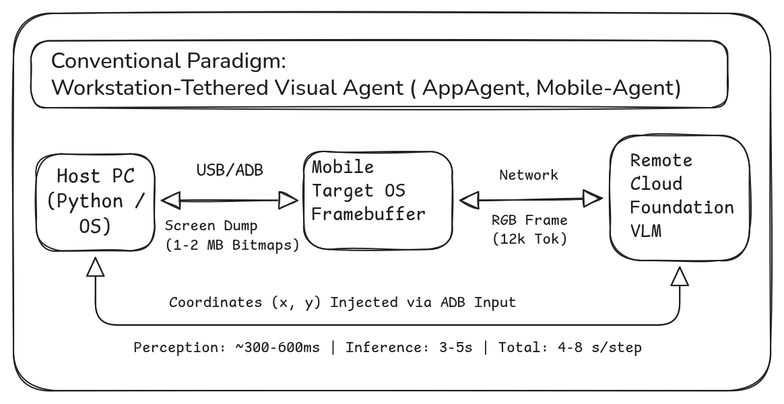
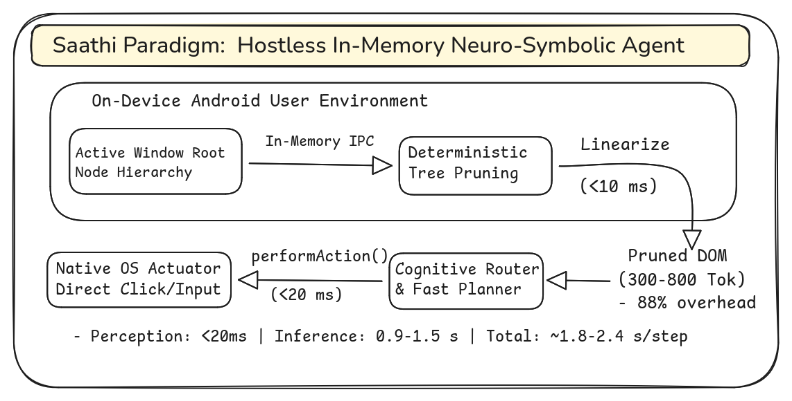
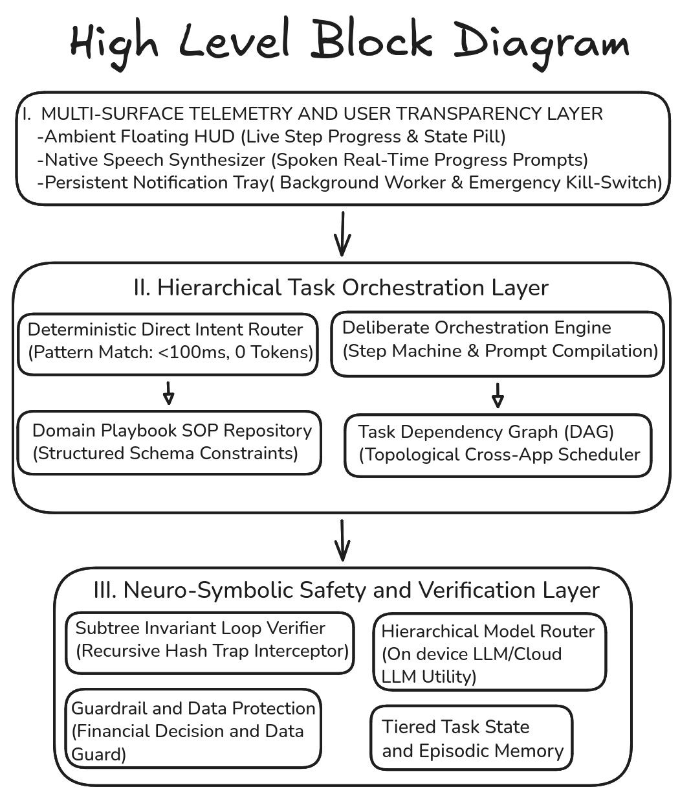
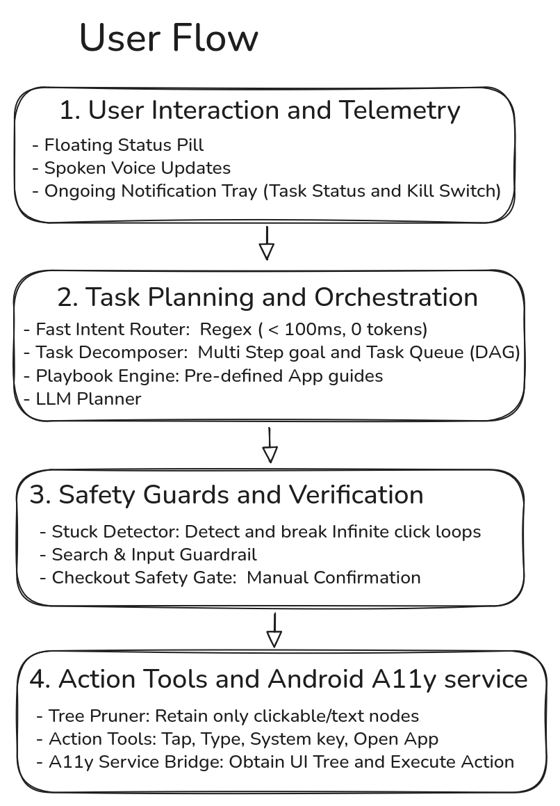
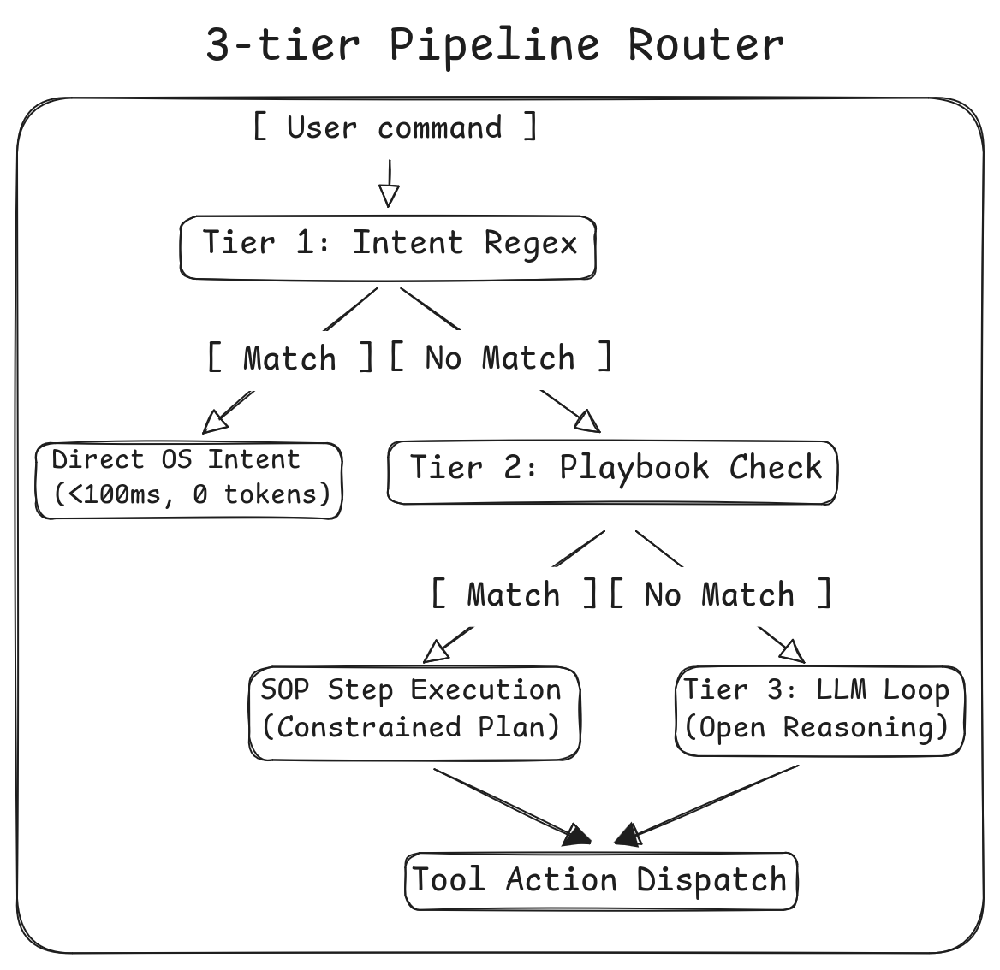
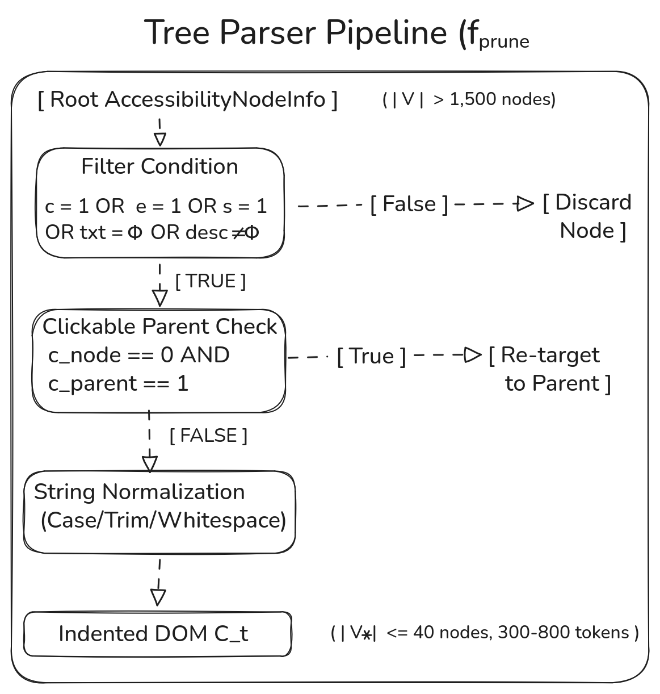
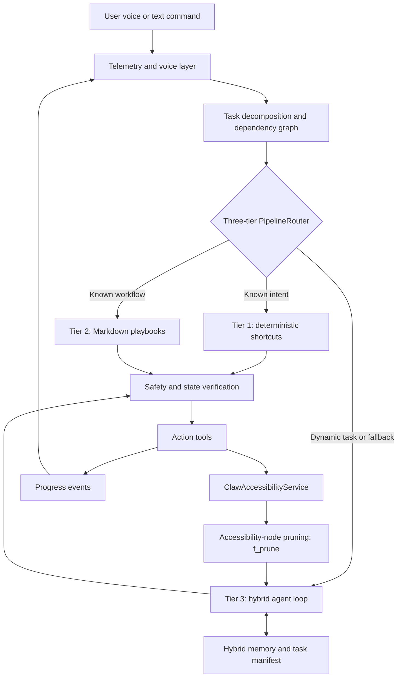
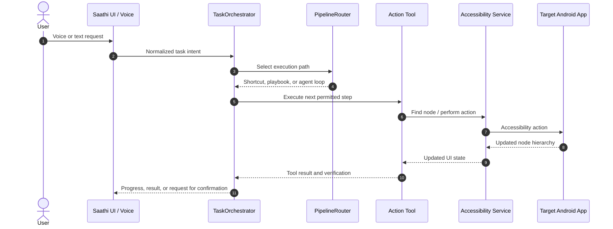

# 🤖 Saathi — Autonomous Android Lifestyle & Quick-Commerce Agent


### A hostless, accessibility-first neuro-symbolic Android agent for everyday tasks

**Saathi** (_companion_) aims to help senior citizens, non-native English speakers, and other users navigate messaging and quick-commerce apps with natural-language or vernacular voice commands.

[Features](#-key-features) · [Architecture](#-system-architecture) · [AI design](#-ai-design-decisions) · [Quick start](#-quick-start) · [Configuration](#-api-configuration) · [Team](#-team-and-acknowledgments)

> **Project / repository name:** The product and architecture are called **Saathi**. The GitHub repository is named **`saarthi`** because the `saathi` repository namespace was already taken. The Android application package is `io.agents.pokeclaw`.

> **Terminology:** “Hostless” means the agent is designed to run on the Android device without a PC or a persistent ADB connection. It does **not** mean that every AI feature is offline: configured cloud models and voice services may still require an internet connection and API keys.

---

> **Technical focus:** Android agents · tool orchestration · accessibility-based UI grounding · context compression · structured task state · multilingual voice interaction · bounded recovery and human approval gates.

## 📋 Table of contents

1. [Overview](#-overview)
2. [Live demo and execution timeline](#-live-demo-uninterrupted-end-to-end-execution)
3. [Motivation and design philosophy](#-motivation-and-design-philosophy)
4. [Key features](#-key-features)
5. [AI and agent engineering highlights](#-ai-and-agent-engineering-highlights)
6. [Visual system architecture](#-visual-system-architecture)
7. [System architecture](#-system-architecture)
8. [User journey](#-user-journey-whatsapp-to-cart)
9. [AI design decisions](#-ai-design-decisions)
10. [Core algorithms and safety](#-core-algorithms-and-safety)
11. [Tool registry](#-tool-and-skill-registry)
12. [Technology stack](#️-technology-stack)
13. [Project structure](#-project-structure)
14. [Quick start](#-quick-start)
15. [API configuration](#-api-configuration)
16. [Permissions and privacy](#-permissions-privacy-and-safety)
17. [Performance notes](#-performance-notes)
18. [Team and acknowledgments](#-team-and-acknowledgments)
19. [Project status and limitations](#-project-status-and-limitations)

---

## 🎯 Overview

**Saathi** is an Android lifestyle-automation project that connects conversational intent to actions across apps. Its primary workflow is to read a shopping list from a user-selected WhatsApp conversation, turn the message into structured shopping items, and help populate a cart in a supported commerce app.

Rather than depending on screenshots and coordinate taps from an external computer, Saathi uses Android's native `AccessibilityService` interface to inspect the active UI hierarchy and perform supported UI actions. A task router selects between deterministic shortcuts, predefined playbooks, and an LLM-based agent loop depending on the command and current screen.

### Design goals

- **Accessibility first:** make multi-step app workflows easier for users who find complex interfaces difficult to navigate.
- **Language flexibility:** accept voice or text commands, including supported vernacular and code-mixed input.
- **Less brittle UI interaction:** prefer accessibility nodes, labels, and resource IDs over screenshot coordinates where possible.
- **Stateful cross-app workflows:** preserve extracted items and task progress while switching between apps.
- **Safety and transparency:** show task progress, support task cancellation, verify important targets, and stop before payment authorization.
- **Tiered reasoning:** avoid unnecessary LLM calls for tasks that can be resolved deterministically.

## 🧪 AI and agent engineering highlights

For AI/agent engineering reviewers, Saathi brings together several practical systems ideas:

- **Hybrid control and model routing:** handle predictable intents with deterministic shortcuts, reusable workflows with playbooks, and unfamiliar states with a model-backed agent path.
- **Tool-oriented execution:** separate planning from Android actions through named tools, so UI operations can be checked and reported rather than expressed only as free-form model output.
- **Context engineering:** prune and normalize the accessibility hierarchy before using it for target matching or model context, instead of sending a full screenshot for every interaction.
- **Long-horizon task state:** preserve a structured `CartItem` manifest and explicit task states across app transitions.
- **Reliability mechanisms:** verify recipients and UI targets, detect repeated states, limit recovery attempts, and keep payment authorization under user control.
- **Multilingual interaction:** normalize voice or code-mixed requests into a task representation while keeping user-facing feedback separate.

These are the project's stated design and implementation areas. The exact availability of individual tools and integrations depends on the checked-out branch and its configuration. Performance values later in this README are project-reported figures, not independently audited benchmarks.

---

## 🎥 Live demo: uninterrupted end-to-end execution

**Watch the full raw recording:** the video preserves the execution sequence rather than presenting only a short edited highlight.

[](https://www.youtube.com/watch?v=E9Pu8WykxIQ)

**[Open the full demo on YouTube](https://youtu.be/E9Pu8WykxIQ)**

### Execution timeline

The timestamps below refer to the linked recording and help reviewers jump directly to each stage.

| Timestamp                                   | What happens                                                           |
| ------------------------------------------- | ---------------------------------------------------------------------- |
| [00:30](https://youtu.be/E9Pu8WykxIQ?t=30)  | Command execution begins.                                              |
| [00:35](https://youtu.be/E9Pu8WykxIQ?t=35)  | The agent confirms its interpretation of the user's intent.            |
| [00:56](https://youtu.be/E9Pu8WykxIQ?t=56)  | Task execution begins.                                                 |
| [01:08](https://youtu.be/E9Pu8WykxIQ?t=68)  | The active app switches to Flipkart.                                   |
| [01:25](https://youtu.be/E9Pu8WykxIQ?t=85)  | The agent selects the Flipkart Minutes tab from the header navigation. |
| [01:34](https://youtu.be/E9Pu8WykxIQ?t=94)  | Product search and cart operations begin.                              |
| [01:45](https://youtu.be/E9Pu8WykxIQ?t=105) | The Munch product is added to the cart.                                |
| [02:00](https://youtu.be/E9Pu8WykxIQ?t=120) | The agent reads the visible cart status.                               |
| [02:20](https://youtu.be/E9Pu8WykxIQ?t=140) | The task status summary reports Task 1 as complete.                    |
| [03:00](https://youtu.be/E9Pu8WykxIQ?t=180) | The agent starts processing the second product.                        |
| [04:00](https://youtu.be/E9Pu8WykxIQ?t=240) | The second product is added to the cart.                               |
| [04:29](https://youtu.be/E9Pu8WykxIQ?t=269) | An incorrect tap occurs.                                               |
| [04:44](https://youtu.be/E9Pu8WykxIQ?t=284) | The agent recovers from the incorrect tap.                             |
| [05:30](https://youtu.be/E9Pu8WykxIQ?t=330) | Task 2 is reported as complete.                                        |
| [05:36](https://youtu.be/E9Pu8WykxIQ?t=336) | The agent switches to WhatsApp for the next action.                    |
| [05:44](https://youtu.be/E9Pu8WykxIQ?t=344) | The WhatsApp video call is successfully placed.                        |

### What this run demonstrates

- **Different workflows use different levels of determinism.** WhatsApp automation is deliberately playbook-heavy because its tested flows can be expressed as predictable steps. This reduces unnecessary model decisions and helps the agent execute those flows quickly.
- **The Flipkart segment is agent-driven.** Product selection and cart interactions use the general agent rules and guardrails rather than relying on a dedicated deterministic playbook for every product interaction. This demonstrates a more flexible path, but it also adds model-inference and sequential API-round-trip latency.
- **Recovery is visible, not edited out.** The recording includes an incorrect tap at 04:29 and recovery by 04:44. This is evidence of recovery in this run, not a claim that every UI error is recoverable.
- **The runtime is end-to-end.** Elapsed time includes UI transitions and loading, model inference, network/API round trips between decisions, and action verification. It should not be interpreted as pure LLM inference time.

The recording is a qualitative demonstration of one execution, not a statistically controlled benchmark. Results can vary with the device, app UI, network, model/provider latency, and target account or region.

## 💛 Motivation and design philosophy

Modern messaging and commerce apps can present accessibility and usability challenges:

- **Interface complexity:** changing banners, nested categories, hidden search fields, and product variants can make navigation error-prone.
- **Language barriers:** users may prefer regional Indic languages or code-mixed speech rather than English-only commands.
- **Chat-to-cart friction:** moving a list from a conversation into a delivery app can require repeated copying, app switching, and product selection.
- **Long-running tasks:** a workflow can fail if its progress or extracted data is lost during an app transition.

Saathi is designed as a digital companion that interprets a user's intent, manages a structured plan, executes permitted UI actions, and communicates progress back to the user.

## ✨ Key features

### 🛒 Quick-commerce and e-commerce workflows

- **WhatsApp-to-cart pipeline:** extract shopping items from a selected conversation and process them as a structured manifest rather than repeatedly revisiting the chat.
- **Multi-item processing:** add requested items sequentially in the target commerce app.
- **Variant handling:** resolve common quantity, size, or weight options such as `250ml`, `500ml`, or `1kg` when those options are available in the UI.
- **Cart inspection:** read cart rows and compare them with the extracted manifest before presenting a summary.
- **Serviceability checks:** detect UI messages indicating that a store or item is unavailable when those messages are exposed through the accessibility hierarchy.
- **Commerce app drivers:** the project describes workflows for Blinkit, Zepto, Flipkart Minutes, and Amazon. Actual behavior depends on the installed app versions, account, location, and current UI structure.

### 💬 WhatsApp and communication tools

- Resolve configured contact aliases such as “Mom” or “Grandpa”.
- Read message text after the chat UI has settled and filter common UI labels from the extracted content.
- Verify the destination chat header before sending or forwarding a message.
- Summarize actionable tasks from a conversation or group where supported.
- Place phone or WhatsApp voice/video calls through the relevant UI workflow.
- Enter a `CallInProgress` state to suppress narration and pause other automation while a call is active.
- Support notification-based auto-replies for configured contacts when notification access and the relevant AI configuration are enabled.

### 🗣️ Voice and multilingual interaction

- Accept spoken commands through the configured speech-to-text path.
- Rewrite code-mixed or vernacular requests into a normalized task representation for downstream planning.
- Keep a natural-language response for spoken feedback where supported.
- Use Sarvam AI speech services for supported transcription and text-to-speech workflows.

### 📡 Live telemetry and user control

- Floating status pill for task state and step progress.
- Foreground notification for ongoing execution.
- Spoken progress updates where enabled.
- Emergency **KILL TASK** action to cancel active orchestration work.
- Explicit task states for planning, execution, recovery, waiting for the user, completion, failure, and cancellation.

### 🛡️ Safety-oriented behavior

- Prefer semantic accessibility selectors over screen coordinates.
- Detect repeated UI states and attempt bounded recovery.
- Verify intended contacts and key UI targets before high-impact actions.
- Keep checkout/payment authorization under user control; the intended workflow stops at the cart or confirmation gate instead of independently authorizing a payment.

---

## 📸 Visual system architecture

The six diagrams below are referenced from the `images/` folder in the repository. Use the exact filenames shown in the image links; GitHub paths are case-sensitive.

### 1. Conventional workstation-tethered visual agents



A conventional visual agent may capture screenshots through ADB, transfer them to a host or cloud model, and send coordinate actions back to the device. Saathi is designed to avoid that persistent PC/ADB dependency for its main interaction loop.

### 2. Saathi's hostless Android approach



The Android accessibility service obtains the available window-node hierarchy through Android's accessibility APIs. A local pruning step creates a smaller representation for matching or model input.

### 3. High-level architecture



### 4. End-to-end user flow



### 5. Three-tier pipeline router



### 6. Accessibility-tree pruning pipeline



---

## 🏗️ System architecture

Saathi separates the runtime into four cooperating layers.



### I. Telemetry and voice layer

The user-facing layer provides the chat interface, floating status pill, foreground notification, and optional spoken progress. This layer is intended to make task execution visible and interruptible rather than silently operating in the background.

### II. Hierarchical orchestration layer

`TaskQueueDecomposer` breaks a compound instruction into smaller tasks. `TaskDependencyGraph` preserves task dependencies and orders execution. `PipelineRouter` chooses deterministic shortcuts, documented playbooks, or the model-driven loop.

### III. Neuro-symbolic safety and verification layer

Programmatic guards, task-state tracking, contact/header checks, subtree-hash loop detection, and the checkout safety gate constrain the actions that the agent can attempt.

### IV. Native Android perception and actuation layer

`ClawAccessibilityService` interacts with the currently available accessibility hierarchy. `NodeFinder` prunes and normalizes nodes, while domain tools perform tasks such as reading messages, searching a catalog, selecting variants, and inspecting a cart.

### Component interaction



---

## 🛒 User journey: WhatsApp to cart

The typical multi-app workflow is designed around a single structured shopping manifest.


### Workflow principles

1. **Read once, execute from the manifest:** the agent extracts the shopping list into structured data before populating the cart.
2. **Minimize app switching:** process items sequentially in the target commerce app after the list has been captured.
3. **Verify actions:** where the accessibility hierarchy exposes enough information, confirm the selected item, variant, or cart row.
4. **Keep payment decisions with the user:** the agent should not treat the appearance of a checkout button as authorization to pay.

---

## 🧠 AI design decisions

### 1. Three-tier deliberation and routing

Not every action requires a model call. `PipelineRouter` separates work into three paths:

| Tier                                | Component                        | Purpose                                                                                               |
| ----------------------------------- | -------------------------------- | ----------------------------------------------------------------------------------------------------- |
| **Tier 1 — deterministic shortcut** | `TaskShortcuts.kt`               | Recognize known intents and use direct Android intents or predefined actions when possible.           |
| **Tier 2 — playbook**               | `PlaybookManager.kt`             | Execute constrained steps from domain-specific Markdown standard operating procedures.                |
| **Tier 3 — agent loop**             | `MultiModelAgentOrchestrator.kt` | Handle dynamic screens and requests that need model-driven reasoning, with fallback and verification. |

A playbook can describe steps for a quick-commerce order, opening/searching an app, or a WhatsApp call/forwarding workflow. If a constrained workflow fails, orchestration can hand control to a fallback path where configured.

### 2. Prompt rewriting and language switching

`PromptRewriter.kt` and the voice-routing components are intended to bridge the language used by the person and the normalized task representation used by tools.

The prompt-rewriting path may produce two outputs:

- `cleanedEnglishTask`: a normalized intent used by the task planner and UI tools.
- `spokenResponse`: a user-facing response that can be spoken in the requested or detected language when the configured speech service supports it.

This separation allows the internal task representation to remain consistent while keeping feedback understandable to the user.

### 3. Long-horizon task planning with a DAG

`TaskQueueDecomposer.kt` decomposes a high-level instruction into atomic subtasks. `TaskDependencyGraph.kt` maintains dependency order—for example:

`WhatsApp read → item normalization → commerce app launch → sequential cart insertion → cart verification`

A dependency graph helps the orchestrator preserve ordering, avoid unnecessary app switching, and recover from a failed step without discarding the entire task context.

### 4. Reactive task state machine

`AgentTaskState.kt` represents the task lifecycle as explicit states instead of relying on loosely coordinated booleans.

```kotlin
sealed interface AgentTaskState {
    object Idle : AgentTaskState
    data class Planning(
        val task: String,
        val isFastPath: Boolean = false
    ) : AgentTaskState
    data class Executing(
        val task: String,
        val stepIndex: Int = 1,
        val plan: List<String> = emptyList()
    ) : AgentTaskState
    data class WaitingForUser(val prompt: String) : AgentTaskState
    data class Recovering(val stepIndex: Int, val reason: String) : AgentTaskState
    object CallInProgress : AgentTaskState
    data class Completed(val result: String) : AgentTaskState
    data class Failed(val error: String) : AgentTaskState
    data class Aborted(val reason: String) : AgentTaskState
}
```

The `CallInProgress` state is intended to pause background task execution and mute spoken narration while a phone or WhatsApp call is active.

### 5. Context maintenance across apps

`MessageToCartPipeline.kt` separates message understanding from UI execution. The extracted list is converted into structured `CartItem` data, which is then consumed by the commerce workflow. This avoids needing to reread or reinterpret the original chat every time the target app changes.

The described `HybridMemoryRepository` combines local persistence (such as SQLite) with optional episodic memory. Memory should be limited to what the workflow needs, and any cloud memory provider should be configured intentionally.

### 6. Speculative node pre-warming

`SpeculativeStepPredictor.kt` attempts to anticipate useful accessibility selectors from the task intent and prepare lookups while an app is opening. The implementation describes a thread-safe cache of candidate nodes. Cached accessibility nodes can become stale after UI changes, so action tools should still verify the current screen before acting.

---

## 🌳 Core algorithms and safety

### 1. Accessibility-tree pruning: `f_prune`

Commerce and messaging apps may expose large accessibility trees. `NodeFinder.kt` filters and linearizes the hierarchy into a smaller structure for semantic matching and model context.

The project describes the following pruning rules:

1. Retain nodes that are clickable, editable, scrollable, or contain useful text/content descriptions.
2. If a matched child is not clickable but its parent is clickable, consider targeting the clickable parent.
3. Normalize text by trimming whitespace, folding case, and standardizing common formatting.
4. Emit a compact, indented representation for the next planning or reasoning step.

A simplified form of the interactive projection is:

\[
V_t^\* = \{v_i \in V_t \mid c_i = 1 \lor e_i = 1 \lor s_i = 1 \lor txt_i \neq \emptyset \lor desc_i \neq \emptyset\}
\]

where `c`, `e`, and `s` indicate clickability, editability, and scrollability. This is a conceptual description of the pruning rule, not a guarantee that every app exposes an equally useful hierarchy.

### 2. Stuck detection and recovery

`StuckDetector.kt` is described as comparing structural hashes of successive accessibility subtrees. If the relevant tree remains unchanged across a configured window of steps, the agent treats this as a possible stuck state.

The intended bounded recovery sequence is:

| Condition              | Recovery action                                                                 |
| ---------------------- | ------------------------------------------------------------------------------- |
| Initial repeated state | Try a safe back action or dismiss a blocking overlay.                           |
| Repeated failure       | Restart the foreground app or reinitialize the current step, where appropriate. |
| Further failure        | Abort the subtask, report the failure, and let the user decide what to do next. |

The implementation should avoid retrying indefinitely. Recovery actions must be bounded and should not bypass confirmation gates.

### 3. Checkout safety gate

Cart population and payment authorization are separate steps. The workflow is designed to stop at the cart/checkout boundary and request explicit user confirmation before any payment-related action. Do not store payment credentials in README files, source code, or ordinary logs.

### 4. Task ordering and app-switch minimization

The dependency graph is intended to reduce repeated transitions between apps while retaining dependencies. Conceptually, the scheduler seeks an ordering that respects task prerequisites and reduces unnecessary changes in the active target app.

---

## 🔧 Tool and skill registry

The source notes list the following tools and responsibilities. The actual availability of each tool depends on the checked-out branch and implementation state.

| Tool                        | Implementation / component                  | Responsibility                                                              |
| --------------------------- | ------------------------------------------- | --------------------------------------------------------------------------- |
| `message_to_cart`           | `MessageToCartTool.kt`                      | Orchestrate WhatsApp list extraction and commerce cart population.          |
| `read_message_items`        | `ReadMessageItemsTool.kt`                   | Read message text and filter common UI noise.                               |
| `find_search_bar`           | `SearchBarService.kt`                       | Locate a commerce app's search field and enter a query.                     |
| `add_to_cart`               | `AddToCartTool.kt`                          | Find a product card, resolve a variant, and attempt to add the item.        |
| `read_cart`                 | `ReadCartTool.kt`                           | Inspect visible cart rows and reconcile them against the manifest.          |
| `send_message`              | `SendMessageTool.java`                      | Send a message after destination checks.                                    |
| `forward_whatsapp_message`  | `WhatsAppForwardTool.kt`                    | Forward a message with destination verification and bounded retry behavior. |
| `place_call`                | `PlaceCallTool.kt`                          | Initiate a phone or WhatsApp call and enter call-lockdown state.            |
| `auto_reply`                | `AutoReplyManager.java`                     | Handle configured notification-based replies.                               |
| `open_app`                  | `OpenAppTool.java`                          | Launch an app and wait for the UI transition.                               |
| `tap_node` / `find_and_tap` | `TapNodeTool.java` / find-and-tap utilities | Find and activate a semantic accessibility target.                          |
| `scroll_to_find`            | `ScrollToFindTool.java`                     | Scroll to a target while detecting repeated UI states.                      |
| `input_text`                | `InputTextTool.java`                        | Enter text through accessibility actions or supported input fallback.       |
| `system_key`                | `SystemKeyTool.java`                        | Dispatch supported global navigation actions.                               |

### Example shopping-item schema

```kotlin
data class CartItem(
    val name: String,
    val rawText: String,
    val quantity: Int = 1,
    val unit: String? = null,
    val preferredBrand: String? = null,
    val maxPriceThreshold: Double? = null,
    var fulfillmentStatus: FulfillmentStatus = FulfillmentStatus.UNFULFILLED
)
```

`rawText` preserves the original extracted wording; the other fields hold normalized item details for search and reconciliation.

---

## 🛠️ Technology stack

| Category                 | Technology                                     | Role described in the project                                            |
| ------------------------ | ---------------------------------------------- | ------------------------------------------------------------------------ |
| Platform                 | Android SDK (API 26+)                          | Native Android runtime and accessibility APIs.                           |
| Languages                | Kotlin and Java                                | Orchestration, service integration, UI actions, and state handling.      |
| UI                       | Jetpack Compose, EasyFloat                     | Chat UI, task telemetry, and floating status display.                    |
| Accessibility            | `AccessibilityService`                         | Inspect available accessibility nodes and dispatch supported UI actions. |
| Notifications            | `NotificationListenerService`                  | Optional notification-driven workflows, including auto-replies.          |
| On-device AI             | Google AI Edge LiteRT / configured Gemma model | Intended local inference for supported tasks.                            |
| Cloud model routing      | OpenRouter and configured models               | Optional reasoning and dynamic-screen fallback.                          |
| Voice                    | Sarvam AI STT and Bulbul TTS                   | Speech transcription and spoken progress.                                |
| Local persistence        | SQLite / local task data                       | Keep task state and structured workflow data.                            |
| Optional episodic memory | Mem0 API                                       | Optional longer-term memory when explicitly configured.                  |

> Model names, API availability, and SDK integration details can change. Use the actual model identifiers and supported runtimes configured by the checked-out code; the names in planning notes are not a guarantee that a particular provider currently exposes them.

---

## 📁 Project structure

The following is the package structure described in the project notes. Exact filenames may differ between branches.

```text
saarthi/
├── app/src/main/java/io/agents/pokeclaw/
│   ├── ClawApplication.kt
│   ├── service/
│   │   ├── ClawAccessibilityService.java
│   │   ├── ClawNotificationListener.java
│   │   ├── SearchBarService.kt
│   │   ├── FloatingCircleManager.kt
│   │   ├── ForegroundService.kt
│   │   └── VoiceManager.kt
│   ├── agent/
│   │   ├── AgentTaskState.kt
│   │   ├── MultiModelAgentOrchestrator.kt
│   │   ├── TaskOrchestrator.kt
│   │   ├── PipelineRouter.kt
│   │   ├── TaskShortcuts.kt
│   │   ├── TaskQueueDecomposer.kt
│   │   ├── TaskDependencyGraph.kt
│   │   ├── PlaybookManager.kt
│   │   ├── SpeculativeStepPredictor.kt
│   │   ├── AutoReplyManager.java
│   │   ├── StuckDetector.kt
│   │   ├── DirectDeviceDataGuard.kt
│   │   ├── InAppSearchGuard.kt
│   │   └── knowledge/
│   │       └── ContactAliasResolver.kt
│   ├── tool/impl/
│   │   ├── MessageToCartPipeline.kt
│   │   ├── MessageToCartTool.kt
│   │   ├── EcommerceAutomationHelper.kt
│   │   ├── AmazonAutomationDriver.kt
│   │   ├── ReadMessageItemsTool.kt
│   │   ├── ReadCartTool.kt
│   │   ├── SendMessageTool.java
│   │   ├── WhatsAppForwardTool.kt
│   │   ├── PlaceCallTool.kt
│   │   ├── TapNodeTool.java
│   │   ├── ScrollToFindTool.java
│   │   ├── InputTextTool.java
│   │   ├── OpenAppTool.java
│   │   └── SystemKeyTool.java
│   ├── ui/
│   │   └── ComposeChatActivity.kt
│   └── utils/
│       ├── NodeFinder.kt
│       ├── ContactListUiUtils.kt
│       ├── ContactMatchUtils.kt
│       └── UiTextMatchUtils.java
├── playbooks/
│   ├── quick-commerce-order.md
│   ├── whatsapp-call-and-forward.md
│   └── open-and-search.md
├── images/
│   ├── conventional_paradigm.png
│   ├── saathi_paradigm.png
│   ├── high_level_block_diagram.png
│   ├── user_flow.png
│   ├── task_router.png
│   └── tree_parser.png
└── README.md
```

---

## ⚡ Quick start

### Prerequisites

- A physical Android device running Android 8.0 (API 26) or later.
- Android Studio and a compatible JDK. The source notes specify JDK 17; use the version required by the checked-out Gradle configuration.
- WhatsApp and any commerce app you intend to test, installed and signed in on the device.
- Internet connectivity and valid provider API keys for cloud model or voice features. Local-only features may have different requirements.

### 1. Clone the repository

```bash
git clone https://github.com/phani554/saarthi.git
cd saarthi
git checkout working_app
```

If `working_app` is not present in the current repository, list available branches with `git branch -a` and check out the branch that contains the Android implementation you intend to use.

### 2. Configure local properties

If the repository provides a template, copy it:

```bash
cp local.properties.example local.properties
```

Edit `local.properties` with the configuration expected by the Gradle project. The API key names below are examples taken from the project notes; confirm that the current source actually reads each property before relying on it.

### 3. Build and install

From the repository root, run:

```bash
./gradlew assembleDebug
./gradlew installDebug
```

You can also open the project in Android Studio, allow Gradle sync to finish, select the app configuration, and run it on a connected Android device. A connected device is needed for installation, but the intended runtime does not require a PC/ADB connection to remain attached during normal phone use.

---

## 🔑 API configuration

The original project notes describe the following sample properties. Add only the keys required by your checked-out implementation and never commit real secrets.

```properties
# Optional cloud-model routing
OPENROUTER_API_KEY=replace_with_your_openrouter_key

# Optional speech-to-text and text-to-speech integration
SARVAM_API_KEY=replace_with_your_sarvam_key

# Optional episodic memory integration
MEM0_API_KEY=replace_with_your_mem0_key

# Optional local model path; use a path supported by the actual runtime
LOCAL_MODEL_PATH=/sdcard/Download/your-supported-model-file
```

### Configuration notes

- Store real API keys in local, untracked configuration or a secure settings flow; do not hard-code them in Kotlin/Java files, screenshots, logs, or this README.
- Keep `local.properties` out of version control. Verify that `.gitignore` excludes it before pushing.
- The local model path is device-specific and must point to a file compatible with the inference runtime integrated into the app.
- Configuring a key does not itself guarantee that a model name, endpoint, or account plan is supported. Check the provider's current documentation and the implementation's request format.
- If the app has an in-app configuration screen, use that screen only after reviewing where and how the app stores the secrets.

---

## 🔐 Permissions, privacy, and safety

Saathi's core behavior relies on Android permissions that can expose sensitive information or allow actions inside other apps. Grant them deliberately and only on a device/account you are authorized to use.

### Permissions described in the project

1. **Accessibility access:** enable Saathi under Android Settings → Accessibility. This enables access to the UI hierarchy and supported actions for the active app.
2. **Display over other apps:** grant overlay permission if you use the floating status pill.
3. **Notification access:** enable notification access only if you intend to use notification-driven workflows or auto-replies.
4. **Microphone and related permissions:** grant these only if required by the installed voice implementation and Android version.

Menu labels vary by Android manufacturer and OS release.

### Important operating principles

- Use the application only with the account owner's consent and in accordance with the relevant app terms and applicable law.
- Review the intended contact, message, product, quantity, variant, and cart before confirming consequential actions.
- Keep payment authorization manual. Do not assume a cart summary is permission to purchase.
- Notification and accessibility data can include private messages and other sensitive on-screen information. Collect and retain only what the workflow needs.
- Understand what is sent to cloud providers when cloud models, speech services, or episodic memory are enabled.
- Disable unnecessary accessibility, overlay, notification, microphone, or API integrations when they are not in use.
- Provide a visible way to stop a task and avoid unbounded automatic retries.

---

## ⏱️ Performance notes

The original project notes report the following values for the intended implementation. Treat them as **project-reported figures**, not independently verified, device-independent benchmarks. Actual latency and behavior can vary with hardware, Android version, app version, network conditions, model provider, and accessibility-tree structure.

| Stage                       | Figure described in the project notes | Interpretation                                                                                                                                       |
| --------------------------- | ------------------------------------: | ---------------------------------------------------------------------------------------------------------------------------------------------------- |
| Tier-1 intent shortcut      |                             `<100 ms` | Target for deterministic known-intent routing.                                                                                                       |
| Accessibility-tree pruning  |                              `<20 ms` | Reported pruning time in the intended path.                                                                                                          |
| Linearizing the pruned tree |                              `~10 ms` | Reported construction time for compact text representation.                                                                                          |
| Compact model context       |                      `300–800 tokens` | Reported range for selected pruned UI contexts.                                                                                                      |
| Native accessibility action |                              `~20 ms` | Reported dispatch latency; app response/rendering adds further time.                                                                                 |
| Commerce item addition      |                    `<150 ms per item` | Project-reported fast action-path figure; not the end-to-end time for searching, waiting for catalog results, reasoning, and verifying the addition. |
| Linked raw execution demo   |        Final listed action at `05:44` | One recorded run containing Flipkart product/cart workflows and a WhatsApp video call; not a general performance benchmark.                          |

The raw demo takes at least 5 minutes and 44 seconds to reach its final listed action. This does not contradict the smaller component-level figures: those figures describe individual fast paths, while an end-to-end agent workflow includes multiple sequential decisions, UI waits, app transitions, and model/API response times. In this recording, the WhatsApp path is playbook-heavy while the Flipkart path is agent-driven, so the two segments should not be treated as identical workloads.

For meaningful benchmarking, record the device, Android release, target-app versions, network state, model/provider configuration, test scenario, number of repetitions, and whether the measurement includes app loading or network round trips. Report component latency separately from full-task wall-clock time.

---

## 👥 Team and acknowledgments

Built at **Vivekanand Education Society's Institute of Technology (VESIT), Mumbai**.

- **Venkat Phaneendra Nittala**
- **Kamya Gupta**
- **Prasanna Nadgauda**
- **Aditi Jadhav**

---

## 📌 Project status and limitations

Saathi is a native Android automation project whose behavior depends on the current code branch, Android permissions, provider configuration, and the UI exposed by third-party apps. Commerce and messaging interfaces can change without notice, so selectors, labels, layout assumptions, and workflows may need maintenance.

The feature list and architecture in this README describe the design and implementation notes supplied for this project; they should not be interpreted as a guarantee that every feature works on every device, account, region, or version of a target app.

---

**Saathi — a more approachable way to interact with everyday mobile apps.**

[Back to top](#-saathi--autonomous-android-lifestyle--quick-commerce-agent)
